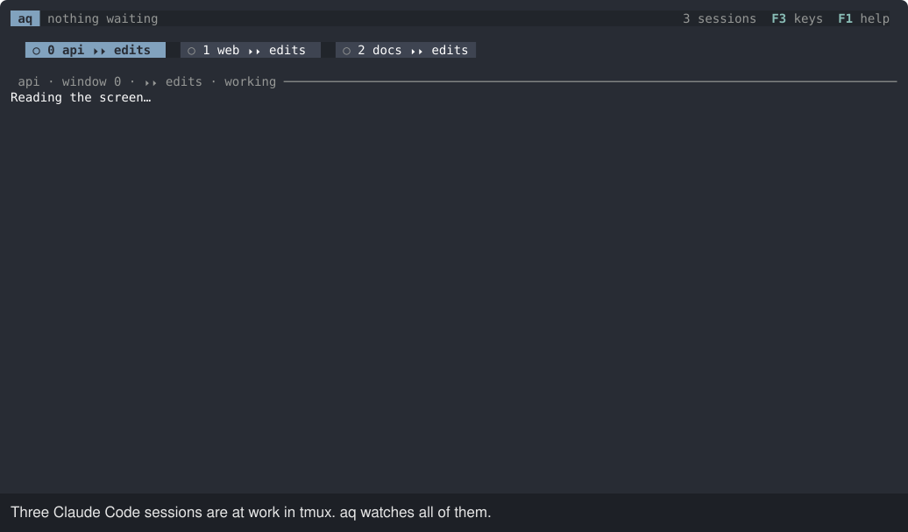
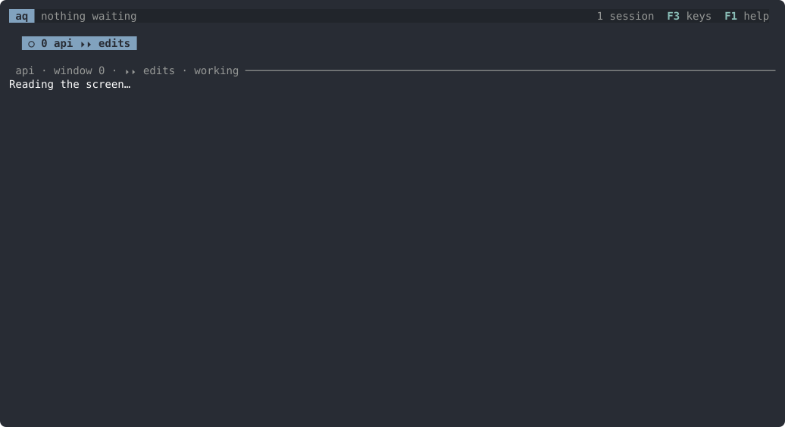
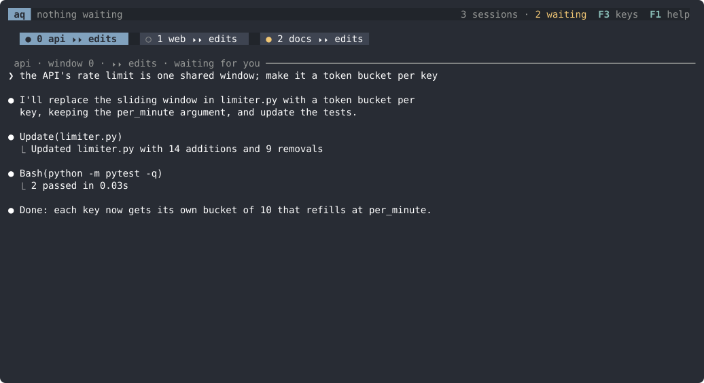

<h1 align="center"></h1>

<p align="center"><b>Every Claude Code session that needs you, in one queue in your terminal.</b><br>
Diffs to review, edits to allow, permission prompts and questions, one card at a time.</p>

<p align="center">
  <a href="https://github.com/nodo-labs-uk/attention-queue/releases/latest"></a>
  <a href="https://github.com/nodo-labs-uk/attention-queue/actions/workflows/release.yml"></a>
  <a href="https://nodo-labs-uk.github.io/attention-queue/"></a>
  
  
  <a href="LICENSE"></a>
</p>

<p align="center">
  <a href="#key-features">Key features</a> ·
  <a href="#get-started">Get started</a> ·
  <a href="#first-keys">First keys</a> ·
  <a href="#see-it-work">See it work</a> ·
  <a href="#compared-with-other-tools">Compared</a> ·
  <a href="https://nodo-labs-uk.github.io/attention-queue/">Documentation</a>
</p>

I run several Claude Code sessions in tmux and kept losing track of which one was waiting on me. aq watches all of them and puts whatever needs me in one queue, shown one card at a time. A card that comes in while I'm on another waits its turn, so nothing takes the screen from under me.



## Key features

### Check what Claude changes

| Feature | What you get |
|---|---|
| [**One queue**](https://nodo-labs-uk.github.io/attention-queue/queue.html) | Diffs, edits, permission prompts and questions from all your sessions arrive as cards, one at a time. |
| [**Review like a PR**](https://nodo-labs-uk.github.io/attention-queue/cards/review.html) | Comment on lines of a finished turn's diff and send them back as one message. |
| [**A mode per project**](https://nodo-labs-uk.github.io/attention-queue/modes.html) | Review each turn, approve each edit, get quizzed on the change, or check nothing. |
| [**GitHub PR review**](https://nodo-labs-uk.github.io/attention-queue/cards/pr-review.html) | `R` opens any open PR as a review card. Comments go to the session to fix, or to GitHub as one review. |

### Answer from one place

| Feature | What you get |
|---|---|
| [**Permission prompts**](https://nodo-labs-uk.github.io/attention-queue/cards/permission.html) | A line from Claude Haiku says what the call does and why. `y` allows it. |
| [**Flagged actions**](https://nodo-labs-uk.github.io/attention-queue/cards/flagged.html) | Merges, pushes to main, force pushes and comments posted as you wait for a yes, in every mode. |
| [**Questions**](https://nodo-labs-uk.github.io/attention-queue/cards/question.html) | A turn that ends with a question becomes a card. `a` approves, `d` says you did what it asked, `Enter` replies. |
| [**Side questions**](https://nodo-labs-uk.github.io/attention-queue/tools.html) | `W` asks where a session is up to, `T` has Haiku sum up its latest turn, and `?` asks anything. A copy answers, so the session never sees it. |

### Run many sessions

| Feature | What you get |
|---|---|
| [**Sessions view**](https://nodo-labs-uk.github.io/attention-queue/sessions.html) | With nothing waiting, watch every session live in tabs. Message one, switch its model, open its `/btw` or `/mcp`, or stop it. |
| [**New sessions**](https://nodo-labs-uk.github.io/attention-queue/new-sessions.html) | `N` starts a session, in a worktree of its own if you like. `O` opens one for each repo in a folder. |
| [**Messages**](https://nodo-labs-uk.github.io/attention-queue/cards/message.html) | A session runs `aq tell` to ask another for work, and you approve the message first. |
| **Restarts** | Unsent comments survive aq restarting, and after a reboot aq reopens the sessions that were open. |

aq is keyboard first, with vim keys and a short tour on the first run. It connects to Claude Code through hooks; if aq isn't running, the hooks do nothing and Claude carries on as normal. [Why it works this way](https://nodo-labs-uk.github.io/attention-queue/introduction.html#design-principles)

## Get started

**You need** Linux, tmux and Claude Code. The GitHub features also need `gh`, logged in as you.

> [!TIP]
> **Quickest install: paste this into Claude Code and let it do the setup.**
>
> ```text
> Set up aq (https://github.com/nodo-labs-uk/attention-queue) for me.
>
> 1. Install it: download aq-x86_64-linux.tar.gz from the latest release
>    (https://github.com/nodo-labs-uk/attention-queue/releases/latest), or
>    clone the repo and run `cargo install --path .`.
>    Make sure `aq` is on my PATH and `aq --help` runs.
> 2. Add the hooks from contrib/settings-hooks.json to
>    ~/.claude/settings.json. Back the file up first. Merge them into the
>    existing PreToolUse, PostToolUse and PermissionRequest arrays, keeping
>    every hook already there, and skip any that are already present. Show me
>    the diff before saving.
> 3. Check that tmux is installed, and tell me which running Claude sessions
>    need a restart to pick up the hooks.
>
> Don't change anything else.
> ```

Then run `aq` in a tmux window. The tour starts on its own.

<details>
<summary>Install by hand</summary>

1. Take the binary from the [latest release](https://github.com/nodo-labs-uk/attention-queue/releases/latest):

   ```sh
   curl -fsSL https://github.com/nodo-labs-uk/attention-queue/releases/latest/download/aq-x86_64-linux.tar.gz | tar xz
   install aq-x86_64-linux/aq ~/.local/bin/
   ```

   or build it from source with `cargo install --path .`.

2. Add the hooks from [`contrib/settings-hooks.json`](contrib/settings-hooks.json) to `~/.claude/settings.json`. Merge them into your existing `PreToolUse`, `PostToolUse` and `PermissionRequest` arrays. If you replace the arrays, your other hooks stop running. [Hooks](https://nodo-labs-uk.github.io/attention-queue/hooks.html) explains each one.
3. Restart Claude sessions that were running before you added the hooks.
4. Run `aq` in a tmux window.

</details>

## First keys

**On a card**

| Key | What it does |
|---|---|
| `y` `n` | allow or refuse an edit or a permission prompt |
| `c` `s` `a` | on a review: comment on a line, send the comments, approve |
| `a` `d` `Enter` | on a question: approve, say you're done ("Done, continue."), or reply |
| `Space` | skip this card for now |
| `M` | switch this project's mode: review, step, quiz, vibe |

**Anywhere**

| Key | What it does |
|---|---|
| `W` `T` `?` | where is the session up to, sum up its last turn, ask it anything |
| `N` `R` | start a new Claude session, review a GitHub PR |
| `!` | a shell in a popup, with Claude's last `! command` typed in |
| `Ctrl-Q` | close any window or popup |
| `F1` `F2` `F3` | every key, the tour again, the keys row along the bottom |

Moving around works as in vim. [Every key](https://nodo-labs-uk.github.io/attention-queue/keys.html)

## See it work

<details>
<summary>Review a finished turn and send the comment back</summary>


</details>

<details>
<summary>Allow or refuse each edit in step mode</summary>


</details>

<details>
<summary>Explain the change in quiz mode</summary>


</details>

<details>
<summary>Answer a question or Claude's own menu</summary>


</details>

<details>
<summary>Switch between sessions and message one</summary>


</details>

<details>
<summary>Start a session in a worktree or a new folder</summary>


</details>

<details>
<summary>Run a command Claude can't, in a shell popup</summary>


</details>

<details>
<summary>The first-run tour</summary>


</details>

## Compared with other tools

| | aq | [Claude Squad](https://github.com/smtg-ai/claude-squad) | [Conductor](https://www.conductor.build) | [Vibe Kanban](https://github.com/BloopAI/vibe-kanban) | [tuicr](https://github.com/agavra/tuicr) |
|---|---|---|---|---|---|
| Runs in | terminal | terminal | macOS app | browser | terminal |
| Works with sessions already running in tmux | ✓ | starts its own | starts its own | starts its own | any repo |
| One queue of what needs you, across sessions | ✓ | list of sessions | list of workspaces | task board | – |
| Line comments go back to the agent | ✓ directly | – | diff view | ✓ | ✓ clipboard or skill |
| Approve each edit before it lands | ✓ | – | – | – | – |
| Quiz on the change | ✓ | – | – | – | – |
| Permission prompts in the same place | ✓ | – | – | – | – |
| Starts new sessions | ✓ in a tmux window | ✓ | ✓ | ✓ | – |
| Sets up a worktree per session | optional, `Tab` on `N` | ✓ | ✓ | ✓ | – |

aq leaves branches and merging to you and Claude: start Claude however you like and aq picks it up. If you'd rather have one app that manages every session's branch for you, one of the others is a better fit.

## Files, development and licence

aq keeps its settings in `~/.config/aq/config.toml` and its state in `~/.local/state/aq/`. [Files and configuration](https://nodo-labs-uk.github.io/attention-queue/configuration.html) lists each file, and how to add your own theme.

`cargo test` runs everything, including end-to-end tests against a private tmux server. `demo/record.py` re-records the videos with fake sessions and a stand-in `claude`, so it needs no login and costs nothing. Pushing a `v*` tag builds a release.

[MIT](LICENSE): use it, change it and share it, for anything.

---

aq was built with [Claude Code](https://claude.com/claude-code). Issues, PRs and other contributions are welcome. You could also point your own agent at this repo and have it build you a version from scratch, but this one saves you the tokens.
