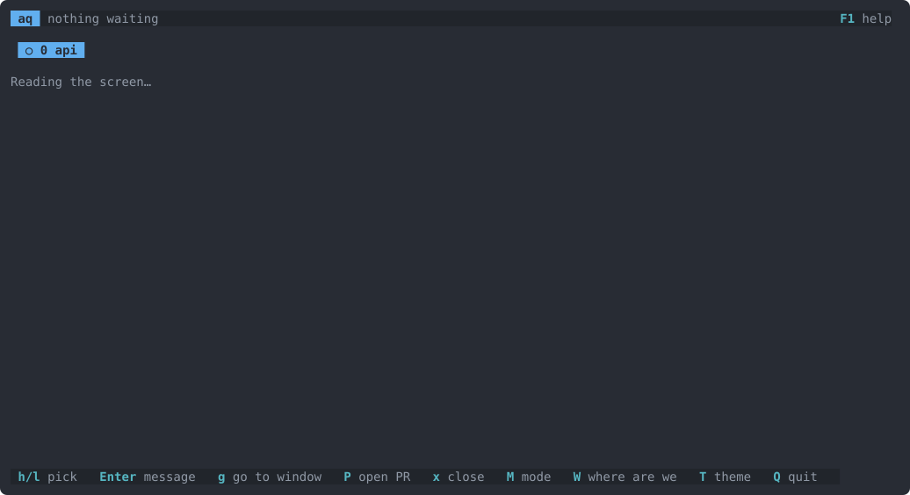
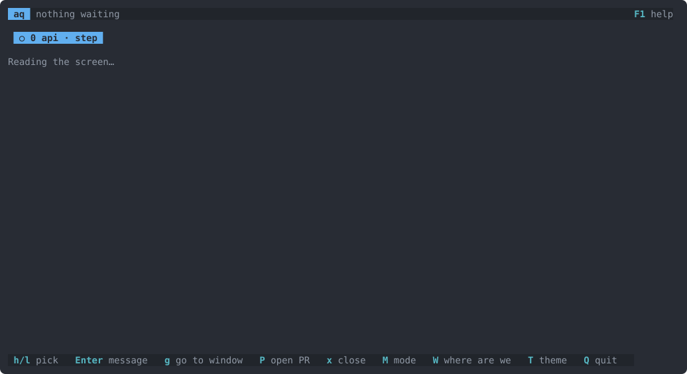
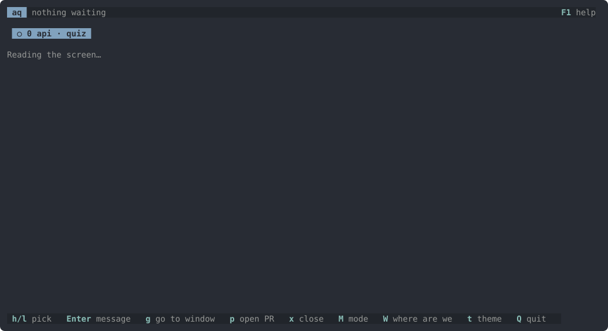
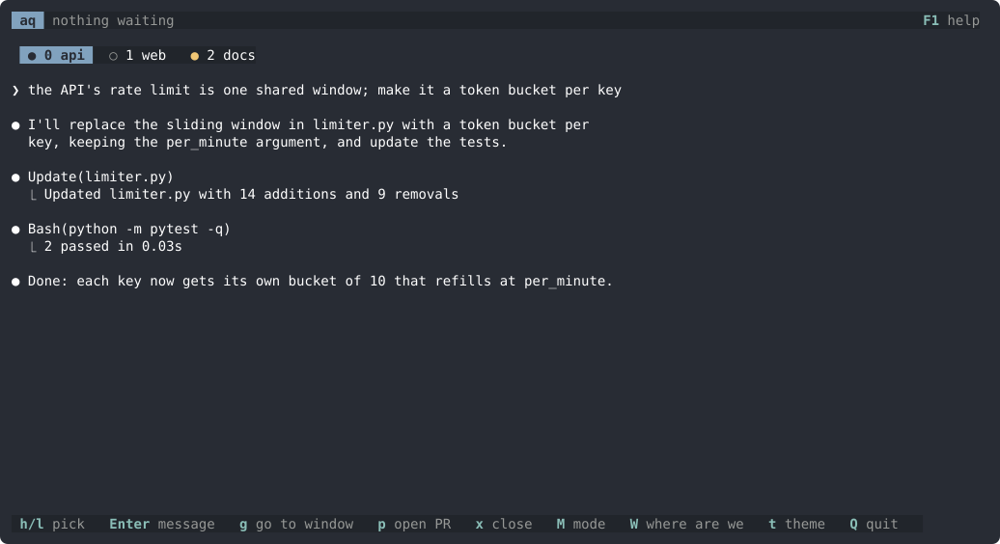
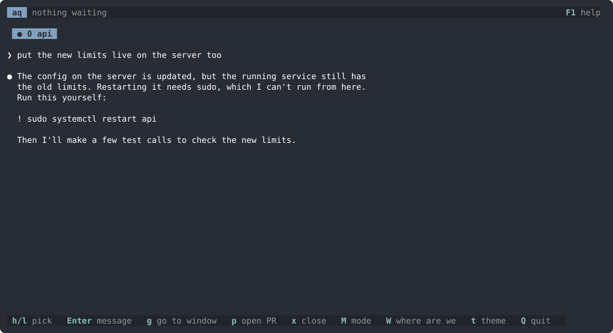
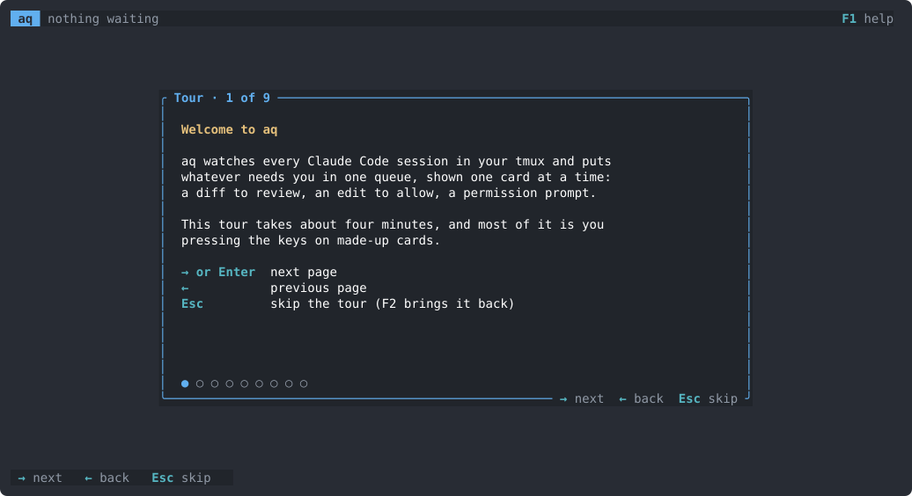

<p align="center"></p>

# aq

I run several Claude Code sessions in tmux and kept losing track of which one was waiting on me. aq watches all of them and puts whatever needs me (a diff to review, an edit to allow, a permission prompt) in one queue, shown one card at a time.



## Why

- The agents aren't the slow part, I am. There is little point running five sessions if I spend my time flicking through windows to find the one that's stuck.
- When a turn ends I want to see the diff, not scroll through the chat. Comments go back as one message, like a PR review.
- Not every project needs the same level of checking. A script can just run, while a payments service should wait for me on every edit, so each checkout has its own mode.
- Skimming a diff and approving it isn't really reviewing it. Quiz mode asks me to explain parts of the change first.
- It shouldn't get in the way. It talks to Claude through hooks, and if aq isn't running (or fails) the hooks do nothing and Claude carries on as normal.

## Modes

Each project has a mode, and `M` switches it.

**Review** (the default): when a session finishes, its diff becomes a card. You can comment on a line or a range, `s` sends all the comments, `a` approves, and `d` marks a file as done so it's out of the way. This is the video above.

**Step**: every edit waits for approval before it's applied. `y` lets it through, `n` sends it back with a reason.



**Quiz**: when a session finishes, aq picks the parts of the diff that matter and asks you to explain what they do, or why they were done that way, in your own words. A judge marks the answer, and any gap it finds can be sent back as a fix.



**Vibe**: nothing is checked; the agent just codes.

## Sessions

When nothing is waiting, there is a tab per session with the selected one's screen live underneath. `Enter` messages it (sent once it's idle), `W` asks where it's up to without interrupting it, `P` asks it to open a PR, and `Esc Esc` stops it. `N` starts a new Claude session in the same project, in a tmux window of its own, with what you type as its first prompt.



`!` opens a shell in a tmux popup, in the project's folder, for things Claude can't run itself: sudo, logins, or commands its permissions block. The last `! command` Claude suggested is copied and, in zsh, already typed in, so Enter runs it. The popup closes when the shell exits.



## Keys

The first time aq starts, a short tour walks through the workflow and its keys; `F2` shows it again, and `F1` lists every key.



The ones worth knowing from day one:

| Key | Where | What it does |
|---|---|---|
| `M` | anywhere | next mode for this project: review, step, quiz, vibe |
| `?` | anywhere | ask the session a side question; a fork answers, so the session never sees it |
| `!` | anywhere | shell in a popup, with Claude's last `! command` typed in |
| `W` | anywhere | ask the session where it's up to |
| `N` | anywhere | start a new Claude session in this project |
| drag | anywhere | select text; letting go copies it |
| `Space` | card | skip it for now |
| `c` `s` `a` | review | comment, send the comments, approve the lot |
| `d` | review | mark a file done |
| `y` `n` | step, permission | allow, or refuse with a reason |
| `h` `l` | sessions | pick a session |
| `Enter` | sessions | message it |
| `Esc Esc` | sessions | stop it |

Moving around works as in vim: `j` `k`, `Ctrl-d` `Ctrl-u`, `gg` `G`, `]c` `[c` for changes and `H` `L` for files.

## Compared with other tools

| | aq | [Claude Squad](https://github.com/smtg-ai/claude-squad) | [Conductor](https://www.conductor.build) | [Vibe Kanban](https://github.com/BloopAI/vibe-kanban) | [tuicr](https://github.com/agavra/tuicr) |
|---|---|---|---|---|---|
| Runs in | terminal | terminal | macOS app | browser | terminal |
| Works with sessions already running in tmux | ✓ | starts its own | starts its own | starts its own | any repo |
| One queue of what needs you, across sessions | ✓ | list of sessions | list of workspaces | task board | – |
| Line comments go back to the agent | ✓ directly | – | diff view | ✓ | ✓ clipboard or skill |
| Approve each edit before it lands | ✓ | – | – | – | – |
| Quiz on the change | ✓ | – | – | – | – |
| Permission prompts in the same place | ✓ | – | – | – | – |
| Starts new sessions | ✓ in a tmux window | ✓ | ✓ | ✓ | – |
| Sets up a worktree per session | – | ✓ | ✓ | ✓ | – |

aq can start a session (`N`), but it doesn't set up worktrees or manage branches: start Claude however you like and aq picks it up. If you'd rather have one app that isolates every session for you, one of the others is a better fit.

## Install

aq runs on Linux, inside tmux. Either take the binary from the [latest release](https://github.com/nodo-labs-uk/attention-queue/releases/latest):

```sh
gh release download --repo nodo-labs-uk/attention-queue --pattern 'aq-x86_64-linux.tar.gz'
tar xzf aq-x86_64-linux.tar.gz && install aq-x86_64-linux/aq ~/.local/bin/
```

or build it from source with `cargo install --path .`.

Then add the hooks from [`contrib/settings-hooks.json`](contrib/settings-hooks.json) to `~/.claude/settings.json`. Merge them into your existing `PreToolUse`, `PostToolUse` and `PermissionRequest` arrays rather than replacing them, or your other hooks will stop running. [docs/hooks.md](docs/hooks.md) has the details.

Run `aq` in a tmux window.

### Or let Claude set it up

Paste this into a Claude Code session:

```text
Set up aq (https://github.com/nodo-labs-uk/attention-queue) for me.

1. Install it: download aq-x86_64-linux.tar.gz from the latest release with
   `gh release download`, or clone the repo and run `cargo install --path .`.
   Make sure `aq` is on my PATH and `aq --help` runs.
2. Add the three hooks from contrib/settings-hooks.json to
   ~/.claude/settings.json. Back the file up first. Merge them into the
   existing PreToolUse, PostToolUse and PermissionRequest arrays, keeping
   every hook already there, and skip any that are already present. Show me
   the diff before saving.
3. Check that tmux is installed, and tell me which running Claude sessions
   need a restart to pick up the hooks.

Don't change anything else.
```

## Files

- `~/.config/aq/config.toml`: the theme, each checkout's mode, and whether the tour has been seen (`T` cycles themes).
- `~/.local/state/aq/state.json`: review rounds, unsent comments and quiz progress, so a restart loses nothing.
- Socket: `$XDG_RUNTIME_DIR/aq.sock`, or `/tmp/aq-$UID/aq.sock`. `AQ_SOCKET` overrides it.

## Development

`cargo test` runs everything, including end-to-end tests against a private tmux server. `demo/record.py` re-records the videos with fake sessions and a stand-in `claude`, so it needs no login and costs nothing. Pushing a `v*` tag builds a release.

## Licence

[MIT](LICENSE): use it, change it and share it, for anything.

---

aq was built with [Claude Code](https://claude.com/claude-code). Issues, PRs and other contributions are welcome. You could also point your own agent at this repo and have it build you a version from scratch, but this one saves you the tokens.
